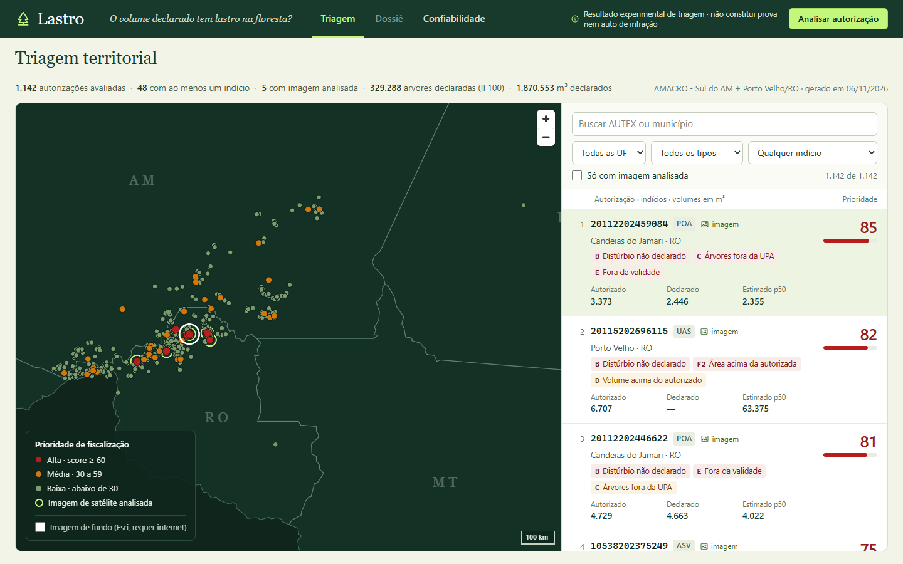

# Lastro

**O volume de madeira declarado tem lastro na floresta?**

O Lastro é uma triagem para priorizar a fiscalização da exploração madeireira na Amazônia. Para cada autorização, ele cruza três coisas: o polígono e o volume autorizados (Sinaflor/PAMGIA, POA, DOF AUTEX), cada árvore que o detentor declarou como explorada (IBAMA IF100, com coordenada, volume e data) e o que os satélites Sentinel-2 (10 m) e CBERS-4A (2 m) mostram. O resultado é uma fila ordenada de autorizações com indícios explicáveis, cada um com regra, limiar, evidência e fonte.

> **Aviso de uso.** Resultado experimental de triagem. **Não constitui prova nem auto de infração.** Indica onde olhar primeiro. A conclusão exige vistoria e análise técnica humana.



*Triagem com dados reais do polo AMACRO (06/11/2026). Dossiê ([exemplo](tests/web/screens/real-03-dossie-a-evidencia.png)) e Confiabilidade completam a jornada.*

## Rodar a demo (1 comando)

```powershell
.\scripts\serve.ps1
```

O script compila o front (`web/`) e sobe a API em <http://127.0.0.1:8000>. A API lê `data/artifacts/` quando existe `index.json`; senão, usa o mock `data/artifacts-mock/`. Para forçar uma raiz: `$env:LASTRO_ARTIFACTS = 'data/artifacts'`.

Pré-requisitos: Python 3.11 com [uv](https://docs.astral.sh/uv/), Node 24 e, para reprocessar imagens, Google Earth Engine autenticado (`uv run earthengine authenticate`).

## Reprocessar do zero

```powershell
uv run python -m pipeline.ingest.run_all          # PAMGIA, IF100, POA/AUTEX, DETER/PRODES, regras C/D/E, pré-triagem
uv run python -m pipeline.detect.train            # detector LightGBM (GroupKFold espacial) -> metrics/detector.json
uv run python -m pipeline.volume.calibrar --baixar --n 72   # baixa S2 das UPAs de calibração
uv run python -m pipeline.volume.calibrar         # quantis + conformal -> metrics/calibracao.json, montecarlo.json
uv run python -m pipeline.export.run --top 80     # dossiês com imagem + todas as autorizações documentais -> index.json
```

Os dados brutos ficam em `data/raw/` (`scripts/download_bg.ps1`). Todas as etapas usam cache; passe `--force` em `run_all` para reconstruir. Testes: `uv run pytest tests`.

## Números do polo AMACRO (verificados)

| Item | Valor | Fonte |
|---|---|---|
| Autorizações no polo | **1.142** (1.079 POA, 40 ASV, 23 UAS) | PAMGIA/Sinaflor |
| Árvores declaradas como exploradas (2022+, com coordenada) | **329.288** registros, 1,87 milhão de m³ | IBAMA IF100 |
| Autorizações com indício documental | C = **11**, D = **10**, E = **29** (46 com ao menos um) | `data/processed/regras_doc.parquet` |
| Árvores com coordenada incoerente (> 5 km do polígono) | **810**, tratadas como qualidade cadastral, não como indício | IF100 + PAMGIA |
| Razão explorado/autorizado (IF100, agregada por autorização) | mediana **0,98**, p95 **1,05** | IF100 |
| Detector LightGBM vs baseline Otsu (fora da amostra, 65.500 px) | IoU **0,561** vs 0,283 · F1 **0,719** vs 0,442 | `data/artifacts/metrics/detector.json` |
| Deep learning (Colab, experimental, mesmos 1,98 mi px, blocos de 25 km) | U-Net siamesa IoU **0,742** × LightGBM 0,705 × Otsu 0,432. Ainda não integrada; o operacional segue LightGBM | `data/artifacts/metrics/dl.json` |
| Calibração imagem → volume (72 UPAs, 17.193 células, GroupKFold por UPA) | cobertura empírica p10–p90 de **84,2%** por célula (78,8% antes do conformal) e **88,9%** por UPA, contra 80% nominais | `data/artifacts/metrics/calibracao.json` |
| Triagem exportada | 1.142 autorizações reais + 1 cenário SIMULAÇÃO; **38** com análise de imagem; **61** com ao menos um indício (A 1 · B 34 · C 11 · D 10 · E 29 · F2 2) | `data/artifacts/index.json` |
| Comunicações ao IBAMA (prioridade ≥ 70) | **14** protocolos gerados automaticamente (13 reais + 1 simulado) | `/api/comunicacoes` |

## Comunicação automática ao IBAMA (regra de limiar)

Quando um caso atinge **prioridade ≥ 70** (score ≥ 0,70) e tem ao menos um indício, o sistema **gera automaticamente um protocolo de comunicação** destinado à Ouvidoria do IBAMA (canal oficial Fala.BR). O protocolo contém: AUTEX/DOF de referência, volumes (autorizado, declarado e estimado p10–p90), indícios com regra e evidências, limitações, proveniência, link do dossiê e **hash SHA-256** do pacote. Tudo fica numa trilha de auditoria (tela **Comunicações**).

Salvaguardas:
- O envio exige **confirmação de um servidor identificado, com justificativa** (`LASTRO_CONFIRMACAO_HUMANA=1`, padrão). O score é índice de prioridade, não probabilidade de irregularidade.
- Cenários `SIMULAÇÃO` **nunca** são enviados.
- O conector padrão é `simulado`: grava numa caixa de saída local, sem contato externo. `LASTRO_CONECTOR=falabr` gera o texto para protocolo no Fala.BR, que não tem API pública. `LASTRO_CONECTOR=email` envia por SMTP (`LASTRO_SMTP_HOST`, `LASTRO_EMAIL_DESTINO`…) e só deve ser ativado mediante acordo institucional.
- O limiar é configurável: `LASTRO_LIMIAR_COMUNICACAO` (padrão `0.70`). Código em [`pipeline/comunicacao.py`](pipeline/comunicacao.py).

## Documentação

- [docs/METODO.md](docs/METODO.md): pipeline ponta a ponta, as 7 assinaturas com regras e limiares, conversão imagem → volume (quantis, conformal, Monte Carlo) e corte raso.
- [docs/MODEL_CARD.md](docs/MODEL_CARD.md): detector, calibração, DL do Colab, usos, vieses, ética.
- [docs/FONTES.md](docs/FONTES.md): fontes, URLs, datas, licenças e limitações.
- [pitch/deck.html](pitch/deck.html) e [pitch/ROTEIRO.md](pitch/ROTEIRO.md): apresentação de 5 minutos.

## Estrutura do repositório

```
contracts/        contrato de artefatos (pydantic + TypeScript), fonte única da verdade
pipeline/
  ingest/         PAMGIA, IF100 (normalização de coordenadas), POA/AUTEX, DETER/PRODES, regras C/D/E, pré-triagem
  imagery/        Sentinel-2 via GEE (par pré/pós, Δ-índices), CBERS-4A por janela COG, renderização
  detect/         baseline Otsu + LightGBM, validação espacial
  grid/           células de 100 m em UTM
  volume/         calibração quantílica + conformal, Monte Carlo, corte raso
  rules/          assinaturas A, B, C, D, E, F2, F6 e score
  export/         dossiês e index.json
  live.py         análise sob demanda (POST /api/analyze/{autex})
api/              FastAPI somente leitura + análise ao vivo
web/              React + Vite + MapLibre: Triagem, Dossiê, Confiabilidade
colab/            notebook de deep learning (U-Net siamesa / Prithvi), opcional
data/
  raw/            downloads brutos (não versionado)
  processed/      parquet intermediários (ver data/processed/README.md)
  artifacts/      saída consumida pela API (contrato v1)
  artifacts-mock/ mock completo para desenvolvimento
docs/  pitch/  tests/  scripts/
```

## Licenças das fontes

| Fonte | Licença declarada pelo publicador |
|---|---|
| IBAMA Sinaflor (POA, ASV, UAS) | Outra (Aberta), dados abertos IBAMA |
| IBAMA DOF (AUTEX, Transportes) | Outra (Domínio Público) |
| IBAMA IF100 | Nenhuma licença informada no portal (dado público) |
| IBAMA PAMGIA | Serviço público, sem licença explícita |
| INPE DETER / PRODES (TerraBrasilis) | CC BY-SA 4.0 |
| INPE CBERS-4A WPM (BDC) | CC BY 4.0 |
| Copernicus Sentinel-2 | Uso livre e aberto com atribuição ("contains modified Copernicus Sentinel data") |
| NASA GEDI L4A, Meta Canopy Height | Abertos (NASA) / CC BY 4.0. Planejados, não integrados |

Detalhes e datas em [docs/FONTES.md](docs/FONTES.md). O Lastro não publica nome, CPF ou CNPJ de detentores. O número AUTEX é público e aparece no app, mas é mascarado nos slides.
