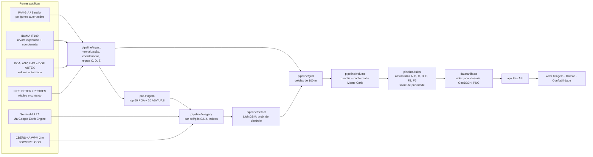

# Método do Lastro

> Resultado experimental de triagem. Não constitui prova nem auto de infração. Toda saída é um **indício** para priorizar fiscalização e exige vistoria e análise técnica.

Pergunta central: **o volume de madeira declarado como explorado tem lastro físico na floresta?** O Lastro cruza, autorização por autorização, o que foi autorizado (Sinaflor/PAMGIA, POA, AUTEX), o que foi declarado como explorado (IBAMA IF100, árvore a árvore, com coordenada) e o que o satélite mostra (Sentinel-2 10 m; CBERS-4A WPM 2 m nos casos de topo).

Polo de demonstração: **AMACRO**, com Humaitá, Lábrea, Novo Aripuanã, Manicoré e Canutama (AM), mais Porto Velho e Candeias do Jamari (RO).

Todos os limiares citados abaixo foram copiados do código (`pipeline/`). Quando o código muda, este documento precisa mudar junto.

---

## 1. Pipeline ponta a ponta

| Etapa | Módulo | Saída |
|---|---|---|
| Ingestão e normalização | `pipeline/ingest/run_all.py` | `data/processed/*.parquet`, `pretriagem.csv` |
| Imagens | `pipeline/imagery/s2.py`, `cbers.py` | `s2_stack.tif` (16 bandas), PNGs em EPSG:4326 |
| Detector | `pipeline/detect/train.py`, `predict.py` | `prob.tif`, máscara, polígonos de mudança |
| Células | `pipeline/grid/celulas.py` | grade de 100 m com volume declarado por célula |
| Volume | `pipeline/volume/calibrar.py`, `estimar.py` | p10/p50/p90 por célula e por UPA |
| Regras e score | `pipeline/rules/flags.py`, `score.py` | flags do contrato `contracts/models.py` |
| Exportação | `pipeline/export/` | `data/artifacts/` (contrato v1) |

### 1.1 Ingestão e qualidade cadastral

- **Polígonos (PAMGIA).** Consulta ao FeatureServer do Sinaflor, filtrada pelos 7 municípios do polo. As partes de uma mesma autorização são dissolvidas num único polígono. Tipos: `PMFS/POA` → POA; ASV; "Uso Alternativo do Solo" → UAS. Resultado: **1.142 autorizações** (1.079 POA, 40 ASV, 23 UAS; 813 em RO e 329 no AM).
- **IF100.** Arquivos de 2022 em diante, só produtos "Tora", datas de exploração a partir de 2022 e duplicatas exatas removidas. Resultado: **329.288 registros de árvores** em 293 autorizações, 324.226 com coordenada válida e 1.870.553 m³ declarados como explorados.
- **Coordenadas do IF100.** O IBAMA publica as coordenadas **sem sinal** e, em parte dos registros, com **latitude e longitude trocadas** (por exemplo `,437689;60,412819`). A correção está em `if100.normaliza_coordenadas`:
  - troca os valores quando |lat| > |lon|;
  - aplica `lat = −|lat|` e `lon = −|lon|`;
  - aceita só |lat| ∈ [0,01; 18] e |lon| ∈ [44; 74] (Amazônia Legal); fora disso, ou com valor zero, a coordenada vira nula.

  Depois disso, se mais da metade das árvores de uma autorização cair a mais de 5 km do polígono, o pipeline testa a latitude positiva e só a adota se ela reduzir a distância. No polo, esse teste não mudou nenhum registro.
- **Distâncias** sempre em SIRGAS 2000 / UTM: EPSG:31980 a oeste de 60° W e EPSG:31981 a leste. Nunca em graus.
- **Volume autorizado** por espécie vem do POA (e dos CSVs de ASV/UAS). Quando a autorização não aparece no Sinaflor, o volume vem do DOF AUTEX, sem somar saldos sobrepostos.
- **DETER e PRODES** (TerraBrasilis WFS) são baixados a partir de 2021 no bbox do polo: 56.257 polígonos DETER e 40.122 PRODES.

### 1.2 Pré-triagem (quem recebe análise de imagem)

`pipeline/ingest/pretriagem.py` pontua cada autorização assim: C +20, D +25, E +20, +2 por alerta DETER no buffer de 2 km (no máximo 10 alertas contados), +1 por polígono PRODES para ASV/UAS (no máximo 10) e +10 se a janela de exploração for de até 90 dias. Proximidade não implica vínculo causal.

São elegíveis os POA com validade iniciada entre 2022 e 2025, pelo menos 200 árvores IF100 e área entre 100 e 5.000 ha; e as ASV/UAS desde 2022, com área entre 20 e 2.000 ha. Saem do ranking **60 POA e 20 ASV/UAS** (8 ASV e 12 UAS). As demais autorizações seguem só com as regras documentais (`analise_imagem = false`).

### 1.3 Imagens

- **Sentinel-2 L2A** (`COPERNICUS/S2_SR_HARMONIZED`) com máscara `S2_CLOUD_PROBABILITY < 40` e SCL excluindo as classes 0, 1, 3, 8, 9, 10 e 11. O composto é a **mediana** do período.
  - Janela pré: estação seca (jun–set) do ano anterior à primeira exploração declarada.
  - Janela pós: da última exploração até 120 dias depois. Se houver menos de 3 cenas limpas (≥ 90% da AOI válida), a janela se estende para 180 dias, porque a clareira de uma árvore se fecha em meses.
- O stack tem 16 bandas em UTM a 10 m, nesta ordem: B2, B3, B4, B8, B11 e B12 pré e pós, ΔNDVI, ΔNBR, ΔNDMI e máscara de validade. Δ = pós − pré, então queda é negativa. B11/B12 (20 m) são reamostradas para 10 m.
- **CBERS-4A WPM** (coleção `CB4A-WPM-PCA-FUSED-1`, RGB fusionado a 2 m) é um **COG**. Cada cena tem cerca de 4 GB, mas o pipeline lê apenas a janela da AOI via `/vsicurl/`. A cena é escolhida pela menor fração de pixels brilhantes (média RGB > 200, heurística de nuvem), com desempate pela data mais próxima, e exige cobertura da AOI acima de 90%. É camada **visual**, usada nos casos de topo.
- **Amazonia-1 (WFI, ~64 m) foi descartado.** A clareira de uma árvore explorada tem 200–600 m², menos de 1/6 de um pixel WFI.

### 1.4 Detector de distúrbio

O detector usa um **LightGBM** por pixel com 21 atributos: as 12 bandas pré/pós, NDVI/NBR/NDMI pré e pós e os três Δ. Os rótulos vêm **só do INPE**: PRODES anual (corte raso) e DETER `CS_DESORDENADO`, `CS_GEOMETRICO` e `DEGRADACAO` (corte seletivo/degradação). Os negativos são floresta estável, com NDVI pré > 0,75 e fora de qualquer alerta.

O IF100 **não** entra no treino do detector. Essa separação evita circularidade: o detector não aprende onde o IBAMA diz que houve corte.

O limiar operacional é **τ = 0,37**, a mediana dos limiares escolhidos por F1 em validação interna de cada fold. O baseline sem treino aplica Otsu sobre Δ-índices, seguido de abertura morfológica 3×3. As métricas estão em [MODEL_CARD.md](MODEL_CARD.md).

### 1.5 Células de 100 m

A grade é alinhada à UTM e cada célula (cerca de 1 ha) é recortada pelo polígono. Para cada célula, o pipeline calcula:

- `vol_declarado`: Σ `VOLUME_EXPLORADO` das árvores IF100 dentro da célula. Um ponto na borda pertence a uma única célula;
- `n_arvores`;
- atributos da imagem: `disturbio_frac` (fração de pixels válidos com prob ≥ τ), `prob_mean`, `dndvi_mean`, `dndvi_p10`, `dndvi_std`, `dnbr_mean`, `dndmi_mean` e `frac_valida`.

Células com `frac_valida < 0,7` são **não observáveis**: não geram indício nem servem de evidência de ausência.

---

## 2. Imagem → volume

### 2.1 Regressão quantílica

O modelo aprende, por célula, o volume declarado em função do que a imagem mostra:

$$y_c = \frac{\text{vol\_declarado}_c}{\text{área}_c}\ \ [\text{m}^3/\text{ha}] \;\sim\; f(x_c),\qquad x_c=(\text{disturbio\_frac},\ \text{prob\_mean},\ \Delta\text{NDVI}_{\mu},\ \Delta\text{NDVI}_{p10},\ \Delta\text{NDVI}_{\sigma},\ \Delta\text{NBR}_{\mu},\ \Delta\text{NDMI}_{\mu})$$

São três LightGBM `objective="quantile"` com α ∈ {0,1; 0,5; 0,9}. Configuração: 300 rodadas, taxa de aprendizado 0,05, 15 folhas, `min_data_in_leaf = 40` e restrições monotônicas (crescente em `disturbio_frac` e `prob_mean`; decrescente em ΔNDVI médio e p10). Os quantis são ordenados e truncados em 0. O volume da célula é $V_{c,k} = \hat q_k(x_c)\cdot \text{área}_c$.

**UPAs de calibração** (`calibrar.candidatos`) são POA do polo com:

- ≥ 50 árvores IF100;
- **fora do top 10 da pré-triagem**, que fica reservado à demo;
- sem indício C;
- **sem alerta DETER intersectando o polígono**;
- exploração entre 2022-06 e 2026-05;
- área ≤ 3.000 ha.

Foram baixados 72 pares S2 com esse critério. Validação: **GroupKFold por UPA (k = 5)**, de modo que nenhuma célula de teste vem de UPA vista no treino.

### 2.2 Calibração conformal (CQR)

Em cada fold, 25% das UPAs de treino formam o conjunto de calibração. O escore de não conformidade e o ajuste são:

$$s_i=\max\big(\hat q_{0,1}(x_i)-y_i,\; y_i-\hat q_{0,9}(x_i)\big),\qquad \hat Q=\text{quantil}_{\lceil (n+1)(1-\alpha)\rceil/n}(s),\ \alpha=0{,}2$$

$$\big[\hat q_{0,1}(x)-\hat Q,\;\hat q_{0,9}(x)+\hat Q\big]\ \text{(truncado em 0)}$$

O modelo final usa todas as UPAs. $\hat Q$ é recalculado num sorteio de 25% das UPAs e gravado em `data/processed/volume/conformal.json`. As métricas (cobertura antes e depois) ficam em [MODEL_CARD.md](MODEL_CARD.md#2-calibração-imagem--volume).

### 2.3 Monte Carlo por UPA

Para somar células sem tratá-las como independentes (`estimar.monte_carlo_upa`, com n = 10.000 e seed 0):

1. A distribuição de cada célula é a CDF linear por partes que passa por (0,1; p10), (0,5; p50) e (0,9; p90), com caudas extrapoladas pela inclinação adjacente e truncadas em 0:
   $$v_c(u)=p50_c+(u-0{,}5)\cdot\frac{p50_c-p10_c}{0{,}4}\ (u<0{,}5),\qquad v_c(u)=p50_c+(u-0{,}5)\cdot\frac{p90_c-p50_c}{0{,}4}\ (u\ge 0{,}5)$$
2. Um **fator comum por UPA** $F\sim\text{LogNormal}(0,\sigma_{upa})$ multiplica todas as células, como correlação espacial simplificada. $\sigma_{upa}$ é o desvio-padrão de $\log\frac{\text{declarado}+1}{\hat p50+1}$ por UPA, fora da amostra, limitado a [0,05; 1,5]. Sem modelo calibrado, o padrão é 0,35.
3. Volume estimado da UPA: $V^{(s)}=F^{(s)}\sum_{c\in UPA} v_c(u_c^{(s)})$. O pipeline reporta p10, p50 e p90 sobre as 10.000 amostras.
4. Subconjuntos:
   - excesso sem lastro $=\sum_{c\in SL}(\text{vol\_declarado}_c-v_c)$;
   - não declarado (dentro e fora da UPA) $=\sum_{c\in ND} v_c$.

### 2.4 Classes de célula

| Classe | Regra (`estimar.classificar_celulas`) |
|---|---|
| `nao_observavel` | `frac_valida < 0,7`, ou distúrbio/p90 nulo. Tem prioridade sobre as demais |
| `sem_lastro` | `vol_declarado > vol_p90` **e** `vol_declarado ≥ 5 m³` |
| `nao_declarado` | `n_arvores = 0`, `disturbio_frac ≥ 0,15` e `vol_p10 > 0` |
| `consistente` | demais células com árvore declarada |
| `sem_atividade` | demais células |

### 2.5 Corte raso (ASV/UAS)

$$V = A\times V_{ha}$$

- **A**: área desmatada detectada (ha). Se vier como faixa p10/p50/p90, é amostrada pela mesma CDF por partes.
- **V_ha, opção 1 (estoque declarado):** $V_{ha}\sim\mathcal N(\bar v,\ 0{,}15\,\bar v)$, com $\bar v$ = volume autorizado (AUTEX) ÷ área autorizada.
- **V_ha, opção 2 (cadeia GEDI, quando não há estoque declarado):**
  $$V_{ha}=\frac{\text{AGB}}{WD\times BEF}\times f_{com},\quad WD\sim\mathcal N(0{,}62;\,0{,}05)\ \text{g/cm}^3,\ BEF\sim\mathcal N(1{,}6;\,0{,}15),\ f_{com}\sim\mathcal U(0{,}3;\,0{,}5)$$
  com AGB pré-evento do GEDI L4A (Mg/ha). A função `volume_corte_raso` implementa essa cadeia, mas a extração automática de AGB (`pipeline/imagery/gedi.py`) **não foi integrada** nesta versão. [a preencher se for integrada]
- n = 10.000 e seed 0. Todos os parâmetros vão para `parametros_volume` do dossiê.

---

## 3. Assinaturas (flags)

Princípios gerais (`pipeline/rules/flags.py`):

- dado ausente vira `nao_avaliado` ou `inconclusivo`, **nunca** `sem_indicio`;
- `sem_indicio`/`nao_avaliado` têm severidade `info`; `inconclusivo` tem no máximo `baixa`;
- tolerância de borda de **20 m** (2 pixels S2).

| Cód. | Título | Regra exata e limiares | Severidade e confiança |
|---|---|---|---|
| **A** | Volume declarado sem lastro observável (POA) | Avaliada em dois níveis onde a incerteza está calibrada, **nunca por árvore ou por célula isolada**. **(i) UPA:** o volume declarado nas células observáveis supera o **p90 do Monte Carlo da UPA**. **(ii) Blocos de 3×3 células (9 ha):** um bloco é `sem_lastro` se Σ declarado > p90 do bloco e ≥ 20 m³. O p90 vem de um Monte Carlo com fator comum por bloco LogNormal(0; σ_bloco = 0,9). Há indício se o excesso somado for ≥ **10%** do declarado **e** ≥ **50 m³**; o limiar de 10% é o p95 da fração de excesso nas 72 UPAs de calibração, e A dispara em 6,9% delas. **Indício** se (i) **ou** (ii). **Inconclusivo** se houver bloco sem lastro com excesso ≥ 5% (metade do limiar), ou se menos de 50% das células com árvore forem observáveis. Sem árvores → `nao_avaliado`. | alta se (i) e (ii), ou excesso ≥ 20%; senão média. Confiança = clip(cobertura da calibração × fração observável; 0,05; 0,95) |
| **B** | Distúrbio sem declaração | Conta polígonos de mudança com **prob média ≥ 0,6**, **≥ 0,5 ha**, **sobre floresta no pré**, fora da UPA a **> 20 m** do limite e **não cobertos por outra autorização**. **Indício** se a área fora for ≥ **1 ha**; no POA, também se o distúrbio dentro da UPA em células sem árvore declarada for ≥ **5% da área da UPA** (estradas e pátios de manejo são esperados). **Sanidade:** área fora > **3×** a autorizada ou > **30% do buffer** → `inconclusivo` (possível artefato sazonal ou desmatamento regional sem vínculo). Alerta DETER coincidente entra como evidência (classe e data). | alta se ≥ 10 ha. Confiança = clip(0,35 + 0,4 × prob média; 0,3; 0,9), +0,1 com DETER coincidente |
| **C** | Árvores declaradas fora do polígono | Coordenada IF100 a **> 20 m e ≤ 5 km** do polígono autorizado. Acima de 5 km é **coordenada incoerente**, tratada como limitação cadastral e não contada como indício. Árvores sem coordenada tornam o resultado `inconclusivo`. | alta se ≥ 5% das árvores ou ≥ 100 m³; média se ≥ 3 árvores. Confiança 0,95 |
| **D** | Volume explorado acima do autorizado | **POA**: Σ explorado (IF100) > Σ autorizado (POA), **ou** razão agregada IF100 Σexplorado/Σautorizado das mesmas árvores **> 1,10**, **ou** intensidade **> 30 m³/ha** (explorado ÷ área PAMGIA). Diferença por árvore acima de 10% é só contexto (cubagem real × inventário). **ASV/UAS**: **p10** do volume estimado (Monte Carlo) > volume autorizado. | POA alta se intensidade > 45 m³/ha, razão > 1,25 ou excesso total; senão média. Confiança 0,9 (POA) / 0,7 (ASV) |
| **E** | Exploração fora da validade | **POA**: alguma data de exploração IF100 fora de [início, fim] da validade (limites inclusivos). **Imagem (ASV/UAS)**: o intervalo da mudança (fim da janela pré → fim da janela pós) é comparado à validade. Fora → indício; **intervalo que cruza a fronteira → `inconclusivo`**; menos de 1 ha de distúrbio → sem indício. | POA alta se ≥ 10% das árvores; senão média. Confiança 0,95 (POA) / 0,7 (imagem) |
| **F2** | Área desmatada acima da autorizada (ASV/UAS) | Σ área desmatada (dentro + contígua até 100 m do limite) **> área autorizada × 1,05**. | alta se razão > 1,25. Confiança 0,8 |
| **F6** | Mudança sobre UC/TI/embargo | Polígono de mudança sobre Unidade de Conservação, Terra Indígena ou embargo, com ≥ 1 ha → indício. **Nesta versão as camadas não foram integradas → `nao_avaliado`.** | alta. Confiança 0,8 |

O limite de 30 m³/ha usado em D segue a referência de intensidade máxima de corte para manejo na Amazônia (Resolução CONAMA 406/2009). O valor está no código como parâmetro (`INTENSIDADE_MAX_M3_HA`), e a fundamentação normativa precisa ser **confirmada por especialista** antes de uso operacional. No polo, a intensidade declarada mediana é 19,9 m³/ha.

O limite de 1,10 para a razão IF100 vem dos dados do polo: em 293 autorizações com árvores, a razão agregada tem mediana 0,98, p90 1,03 e p95 1,05. O valor 1,10 fica acima do p95.

### 3.1 Por que A é agregada (blocos de 9 ha e UPA), e nunca por árvore

1. **Escala física.** A clareira de uma árvore abatida mede 200–600 m², ou 2 a 6 pixels Sentinel-2. Numa mediana sazonal ela é sub-pixel ou ruído, e fecha em meses. "Esta árvore não tem clareira" não é uma afirmação que a imagem sustente.
2. **Erro de GPS.** As coordenadas IF100 têm erro de dezenas de metros e já chegam com problemas de sinal e inversão. Uma árvore declarada pode cair na célula vizinha da clareira real.
3. **Rótulos.** DETER (~3 ha) e PRODES (6,25 ha) não capturam clareiras individuais. O detector aprende distúrbio em área, não árvore.

4. **Calibração.** O R² por célula de 1 ha é cerca de 0 (ver MODEL_CARD): a imagem dá uma faixa confiável, não um número por célula. Agregar em blocos de 9 ha e na UPA é onde a cobertura do intervalo foi medida.

Por isso, a assinatura A só olha o **total da UPA** contra o p90 do Monte Carlo e o **excesso somado em blocos de 9 ha** contra um limiar calibrado nas UPAs sem indício (p95). Divergência pequena ou isolada é `inconclusivo` ou `sem_indicio`.

---

## 4. Score de prioridade

$$\text{score}=1-\exp\Big(-\sum_{f\,:\,status=indicio} w_f\cdot sev_f\cdot conf_f\Big)\in[0,1)$$

- Pesos: A 1,0; B 1,0; F6 1,0; F2 0,9; D 0,8; C 0,6; E 0,6.
- Severidade: alta 1,0; média 0,6; baixa 0,3; info 0.

O score **serve só para ordenar** a fila de fiscalização. Não é probabilidade de irregularidade.

## 5. Proteções contra viés de confirmação

- O detector é treinado só com rótulos INPE; o IF100 só entra na calibração de volume.
- A calibração usa UPAs sem DETER no polígono, sem indício C e fora do top 10 da demo.
- Validação espacial: GroupKFold por blocos de 5 km no detector e por UPA no volume.
- A AOI é o polígono + 2 km **menos os polígonos de outras autorizações**, para não atribuir a um titular o distúrbio de um vizinho licenciado.
- Células não observáveis (nuvem) nunca viram evidência de ausência.
- O dossiê traz `legal_conclusion: false`, proveniência por fonte e limitações específicas do caso.
