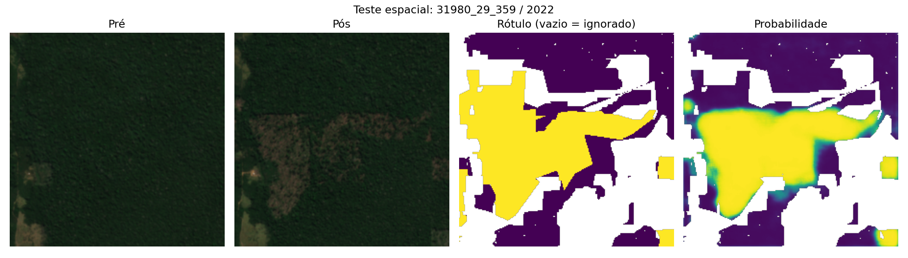

# Model card: Lastro

> Resultado experimental de triagem. Não constitui prova nem auto de infração.

| Campo | Valor |
|---|---|
| Sistema | Lastro: triagem da consistência entre volume de madeira declarado (IF100) e o que o satélite observa |
| Versão | detector operacional `lightgbm` (limiar 0,37) · calibração `lgbm-quantil-v1+cqr` · contrato de artefatos v1.0 · U-Net siamesa (Colab) experimental, ainda não integrada |
| Região | Polo AMACRO: Sul do AM (Humaitá, Lábrea, Novo Aripuanã, Manicoré, Canutama) + Porto Velho e Candeias do Jamari (RO) |
| Período | Explorações e imagens 2022–2026 |
| Arquivos de métricas | `data/artifacts/metrics/detector.json`, `calibracao.json`, `montecarlo.json` |
| Código | `pipeline/detect/`, `pipeline/volume/`, `pipeline/rules/` |

O sistema tem três componentes: (1) um detector de distúrbio florestal por pixel; (2) uma calibração imagem → volume com intervalo; (3) regras de triagem. Os dois primeiros são modelos estatísticos e estão descritos abaixo. As regras estão em [METODO.md](METODO.md#3-assinaturas-flags).

---

## 1. Detector de distúrbio (Sentinel-2)

### Dados
- **Entrada**: stack Sentinel-2 L2A em UTM a 10 m, com medianas da estação seca (jun–set) pré e pós. São 21 atributos por pixel: 12 bandas (B2, B3, B4, B8, B11, B12 pré e pós), NDVI/NBR/NDMI pré e pós, e ΔNDVI, ΔNBR e ΔNDMI.
- **Amostra**: 36 tiles fixos de 5 km (EPSG:31980), 12 por ano em 2022–2024, totalizando **65.500 pixels balanceados**. A seleção favorece tiles com alertas de degradação ou corte seletivo e **não é uma amostra representativa** do polo.

### Rótulos
- **Positivos**: PRODES do ano (corte raso) e DETER de outubro do ano anterior a setembro do ano, nas classes `CS_DESORDENADO`, `CS_GEOMETRICO` e `DEGRADACAO` (corte seletivo/degradação). Quando há sobreposição, DETER seletivo tem prioridade sobre PRODES.
- **Negativos**: NDVI pré > 0,75, fora de todos os alertas DETER retornados e de PRODES desde 2008.
- **Anti-circularidade**: o IF100 não é usado como rótulo do detector.

### Protocolo
- **GroupKFold espacial externo, k = 5, por bloco de 5 km.** Dentro de cada treino externo, um holdout de 25% dos blocos escolhe o limiar por F1. O modelo é então reajustado no treino externo e avaliado no teste externo. As métricas são agregadas fora da amostra (out-of-fold).
- O modelo final é treinado em todos os blocos. O limiar é a **mediana dos limiares internos: 0,37** (folds: 0,31; 0,40; 0,37; 0,50; 0,31).
- **Baseline** sem treino: Otsu sobre o score espectral do tile inteiro, seguido de abertura 3×3.
- Tempo de treino e avaliação: 13,5 s.

### Métricas (fora da amostra, 65.500 pixels)

| Modelo | IoU | F1 | Precisão | Recall |
|---|---|---|---|---|
| Baseline Otsu (Δ-índices) | 0,283 | 0,442 | 0,961 | 0,287 |
| **LightGBM (selecionado)** | **0,561** | **0,719** | 0,746 | 0,694 |

Matriz de confusão do LightGBM, `[[VN, FP], [FN, VP]]`: `[[29.027, 6.973], [9.037, 20.463]]`.

O LightGBM dobra o IoU do baseline. O baseline é muito preciso, mas perde 71% dos distúrbios de referência. Na triagem, distúrbio não detectado vira falso "volume sem lastro", então o recall importa mais.

**Por tipo de distúrbio** (mesmos negativos estáveis em cada estrato):

| Estrato | Modelo | IoU | F1 | Precisão | Recall |
|---|---|---|---|---|---|
| Corte raso (PRODES) | Baseline | 0,479 | 0,648 | 0,942 | 0,494 |
| Corte raso (PRODES) | LightGBM | 0,557 | **0,716** | 0,596 | 0,895 |
| Seletivo/degradação (DETER) | Baseline | 0,152 | 0,263 | 0,889 | 0,154 |
| Seletivo/degradação (DETER) | LightGBM | 0,407 | **0,579** | 0,593 | 0,565 |

O corte seletivo, que é o caso principal do Lastro, é o mais difícil: o modelo encontra cerca de 57% dos pixels de referência. Por isso a decisão é tomada por célula e por UPA, e não por pixel.

### Trilha de deep learning (Colab, experimental)
O notebook `colab/lastro_dl.ipynb` rodou numa Tesla T4 em modo rápido: 400 chips de 224×224 px, 9 épocas e early stopping. O modelo usado foi uma **U-Net siamesa (encoder ResNet34 compartilhado entre pré e pós)**.

Protocolo próprio: blocos UTM de 25 km, split 70/15/15 por bloco, seed 42, 1.977.980 pixels de teste espacial. A amostra é enriquecida em positivos, então não estima prevalência regional.

| Modelo (mesmos chips e pixels de teste) | IoU | F1 | Precisão | Recall |
|---|---|---|---|---|
| ΔNDVI + Otsu | 0,432 | 0,604 | 0,943 | 0,444 |
| LightGBM refeito nos chips | 0,705 | 0,827 | 0,876 | 0,783 |
| **U-Net siamesa** | **0,742** | **0,852** | 0,821 | 0,885 |

Fontes: `data/artifacts/metrics/dl.json` (métricas e config) e as entradas `[Colab]` em `data/artifacts/metrics/detector.json`. Os três modelos foram avaliados **nos mesmos pixels** de teste espacial.

**Leitura.** Nos mesmos pixels, a U-Net supera o LightGBM em **+0,037 de IoU** (0,742 contra 0,705) e em +0,025 de F1. O recall é maior (0,885 contra 0,783), com precisão um pouco menor (0,821 contra 0,876). Para a triagem, recall maior significa menos clareiras perdidas e, portanto, menos falsos "volume sem lastro".

**Comparabilidade.** Esses números **não são comparáveis** com a tabela do detector operacional (blocos de 5 km, 5 folds, 65.500 px). A comparação justa é sempre dentro de cada protocolo.

**Status.** O Prithvi-EO-2.0 foi tentado e caiu no fallback por incompatibilidade de versão TerraTorch/TorchGeo no Colab. A U-Net foi treinada, exportada para ONNX (`data/processed/dl/lastro_unet.onnx`, 95 MB, roda em CPU com ONNX Runtime em cerca de 5 s por autorização) e **integrada ao pipeline** após a validação independente abaixo.

### Validação independente da U-Net e regra operacional (protocolo local)
`pipeline/detect/avaliar_dl.py` e `pipeline/detect/calibrar_dl.py`: 21 blocos de 5 km do dataset do detector que **a U-Net nunca viu** (excluídos os 15 blocos com chips de treino ou validação do Colab), avaliados **parede a parede** (todos os pixels rotulados do bloco). O LightGBM de cada bloco é o modelo do fold em que aquele bloco foi teste. Os blocos foram divididos ao acaso: a regra foi escolhida na metade A e **medida na metade B (10 blocos, 1,54 mi px)**.

| Metade B (mesmos pixels) | IoU | Precisão | Recall | Falso alarme* |
|---|---|---|---|---|
| ΔNDVI + Otsu | 0,198 | 0,981 | 0,198 | 0,5% |
| LightGBM (detector anterior) | 0,451 | 0,814 | 0,503 | 16,1% |
| U-Net siamesa | 0,720 | 0,772 | 0,914 | 37,7% |
| Média (U-Net + LightGBM)/2 ≥ 0,55 | 0,723 | 0,844 | 0,834 | 21,5% |
| **LightGBM + U-Net (AND) · em uso** | 0,455 | **0,881** | 0,485 | **9,2%** |

\*Falso alarme = fração da floresta estável de referência marcada como distúrbio.

**Decisão.** Sozinha, a U-Net acerta muito mais área (IoU 0,720 × 0,451) e venceu o LightGBM em 19 dos 21 blocos. Porém marca floresta intacta demais: nas 72 UPAs limpas da calibração, gerou manchas de cerca de 2 km em dossel sem alteração visível. É uma mudança de domínio, porque o treino usou ≥ 50% de chips positivos. Como casos acima do limiar geram **comunicação ao IBAMA**, a operação prioriza precisão. Adotamos a regra **AND**: o pixel só é distúrbio se o LightGBM e a U-Net concordam. Ela corta o falso alarme de 16,1% para 9,2% (−43%) com IoU equivalente. A média U-Net/LightGBM é a alternativa de maior recall, documentada para uso futuro após mais treino.

**Onde cada modelo é usado.** Detecção espacial (polígonos de distúrbio, áreas dentro/fora, indícios B e F2, camada "prob" no mapa): regra AND. Conversão imagem → volume (indício A, p10/p50/p90): LightGBM, porque recalibrar o volume sobre a U-Net piorou a calibração (R² por UPA 0,21 × 0,33; disparo de A em UPAs limpas 9,7% × 6,9%). O detector é configurável por `LASTRO_DETECTOR=unet|lightgbm`.

**Efeito nos dossiês.** Nos 39 casos com imagem, a área de distúrbio fora da UPA caiu em média cerca de 30% (ex.: 20112202459084: 14,2 → 4,5 ha; 20132202386081: 33,7 → 3,6 ha). Os indícios dos casos de topo se mantiveram, e 11 casos ficaram acima do limiar de comunicação (antes, 13 reais).

Outros exemplos: [2](img/dl_exemplo_2.png) · [3](img/dl_exemplo_3.png) · [4](img/dl_exemplo_4.png). No exemplo 3, a U-Net marca probabilidade alta em parte da área de floresta estável (rótulo negativo) no canto inferior, um tipo de falso positivo a acompanhar.

### Limitações do detector
- **Rótulos fracos.** DETER (~3 ha de área mínima) e PRODES (6,25 ha) não captam todas as pequenas clareiras de manejo seletivo. Ausência de rótulo não garante floresta intacta.
- **Datas.** Os rótulos são anuais (PRODES) ou cobrem a janela out–set (DETER), enquanto o composto é a mediana jun–set. Eventos posteriores à mediana podem estar rotulados como positivos.
- **Prevalência.** A amostra balanceada não representa a prevalência real, e as probabilidades não são calibradas.
- **Validação espacial.** Não há buffer entre blocos vizinhos; a autocorrelação pode deixar as métricas otimistas. Também não há validação temporal independente.
- B11/B12 (20 m) são reamostradas para 10 m, o que não cria detalhe espectral real.

---

## 2. Calibração imagem → volume

### Dados
- **Unidade**: célula de 100 m (≈ 1 ha), recortada pelo polígono da UPA.
- **Alvo**: volume declarado no IF100 por célula, em m³/ha.
- **Atributos**: `disturbio_frac`, `prob_mean`, ΔNDVI (média, p10, desvio), ΔNBR médio e ΔNDMI médio.
- **UPAs de calibração**: POA do polo com ≥ 50 árvores IF100, fora do top 10 da pré-triagem, sem indício C, **sem DETER no polígono**, exploração entre 2022-06 e 2026-05 e área ≤ 3.000 ha. Foram baixados **72 pares S2**. Ficam fora as células com menos de 70% de pixels válidos ou menos de 0,5 ha.

### Modelo
- LightGBM quantílico com α = 0,1 / 0,5 / 0,9 e restrições monotônicas.
- **CQR** (conformal quantile regression) com α = 0,2, sobre 25% das UPAs de treino em cada fold.
- **Monte Carlo** por UPA com 10.000 amostras e um fator comum LogNormal(0, σ_upa) para representar correlação espacial.
- Fórmulas em [METODO.md](METODO.md#2-imagem--volume).

### Protocolo
**GroupKFold por UPA, k = 5.** As métricas são fora da amostra.

### Métricas

Execução de 2026-11-06T07:30Z (`uv run python -m pipeline.volume.calibrar`). Fontes: `data/artifacts/metrics/calibracao.json` e `data/processed/volume/metricas_cv.json`. São **72 UPAs e 17.193 células** válidas, todas avaliadas fora da amostra.

| Nível | Métrica | Antes do conformal | Depois do conformal |
|---|---|---|---|
| Célula (1 ha) | R² (p50) | 0,07 | 0,07 |
| Célula (1 ha) | MAE (p50) | 11,1 m³/ha | 11,1 m³/ha |
| Célula (1 ha) | Largura média do intervalo p10–p90 | 29,8 m³/ha | 32,4 m³/ha |
| Célula (1 ha) | **Cobertura empírica p10–p90** (nominal 80%) | **78,8%** | **84,2%** |
| Bloco 3×3 (9 ha, Monte Carlo, σ_bloco = 0,9) | Cobertura p10–p90 | 66,5% | n/a |
| UPA (soma simples dos quantis) | Cobertura p10–p90 / R² / erro relativo mediano | 93,1% / 0,55 / 42% | n/a |
| UPA (Monte Carlo, fator comum) | R² (p50) | 0,33 | 0,06 |
| UPA (Monte Carlo, fator comum) | Erro relativo mediano | 32% | 29% |
| UPA (Monte Carlo, fator comum) | **Cobertura empírica p10–p90** (nominal 80%) | **87,5%** | **88,9%** |
| — | Ajuste conformal $\hat Q$ por fold | n/a | 0; 0,75; 11,86 m³/ha (final ≈ 0) |
| — | σ_upa (dispersão log por UPA) | 0,64 | n/a |
| — | Taxa de disparo de A nas 72 UPAs de calibração | 6,9% | n/a |

**Como ler.**
- **O intervalo está calibrado** por célula e por UPA. Em UPAs que o modelo não viu, o volume declarado caiu dentro de p10–p90 em 78,8% das células antes do conformal e em 84,2% depois, contra 80% nominais. No total da UPA, a cobertura foi de 87,5% a 88,9%, um pouco conservadora. Isso favorece o titular: menos indícios A.
- **Em blocos de 9 ha a cobertura fica em 66,5%**, abaixo do nominal mesmo com σ_bloco = 0,9, que foi o maior valor testado. Por isso o limiar de A nos blocos não se apoia só no p90: ele é calibrado empiricamente como o p95 da fração de excesso nas UPAs sem indício (10%). Com esse limiar, A dispara em 6,9% das UPAs de calibração.
- **O ponto central não é informativo por célula.** O R² da célula é cerca de 0,07. Numa célula de 1 ha, a imagem quase não prevê *quanto* foi declarado, por causa do erro de GPS, da clareira sub-pixel e da variação de volume por árvore. No total da UPA, o R² fica entre 0,3 e 0,55, com erro relativo mediano de cerca de 30%.
- **Consequência para as regras.** O Lastro nunca usa a mediana (p50) para abrir indício (ver METODO §3). No index de 06/11 (07:33Z), A ficou **sem indício** nos 3 POA com imagem: nenhum bloco de 9 ha passou do p90 com excesso relevante, e o total declarado de cada UPA cabe no intervalo da imagem.
### Limitações da calibração
- **Possível contaminação.** As UPAs "limpas" não têm indício documental nem DETER, mas podem conter divergência não detectada. Se o declarado estiver inflado nelas, a relação declarado/distúrbio aprendida fica inflada, e o Lastro **subestima** o indício A. O viés é conservador para o titular, mas existe.
- **Baixa informação por célula.** O R² da célula é cerca de 0,07, então o modelo serve para dar **faixas** e totais por UPA, não para estimar o volume de uma célula específica.
- **Ajuste conformal instável entre folds.** $\hat Q$ variou de 0 a 11,9 m³/ha, porque depende de quais UPAs caem na calibração. Com mais UPAs, deve estabilizar.
- **Clareira que fecha.** A clareira de uma árvore isolada (200–600 m²) é sub-pixel a 10 m e se fecha em meses. Uma imagem pós tardia mostra menos distúrbio do que houve.
- **Nuvem.** Células com menos de 70% de pixels válidos são descartadas no treino e marcadas como `nao_observavel` na inferência.
- **GPS.** O erro de dezenas de metros nas coordenadas IF100 espalha volume entre células vizinhas.

---

## 3. Usos pretendidos e não pretendidos

**Pretendidos**
- Ordenar a fila de fiscalização e de análise técnica de autorizações de manejo (POA) e de supressão (ASV/UAS).
- Apontar **onde** olhar dentro de uma UPA (células, polígonos de mudança, árvores fora do polígono) e **por quê** (regra, limiar, evidência e fonte).
- Apoiar auditoria de qualidade cadastral, como coordenadas incoerentes e datas fora da validade.

**Não pretendidos**
- Autuar, embargar, suspender ou negar autorização com base apenas no Lastro.
- Afirmar irregularidade de pessoa física ou jurídica. O sistema não usa nem exibe nome, CPF ou CNPJ do detentor.
- Estimar o volume de uma árvore específica ou validar árvore por árvore.
- Usar o score como probabilidade. Ele só ordena casos.
- Aplicar fora do polo AMACRO sem revalidação, porque as métricas podem mudar com floresta, relevo, nuvem e práticas de manejo diferentes.

## 4. Vieses e limitações gerais

| Tema | Efeito | Mitigação no Lastro |
|---|---|---|
| Nuvem e sombra | Células sem observação | `nao_observavel`, sem evidência de ausência; janela pós estendida até 180 dias |
| Clareira que fecha | Distúrbio subestimado, que pode gerar falso indício A | Janela pós de 120–180 dias após a última exploração; A exige p90 e divergência na UPA |
| Área mínima dos rótulos (DETER ~3 ha, PRODES 6,25 ha) | Recall menor para corte seletivo (F1 0,58) | Decisão por célula e UPA; métrica por tipo publicada |
| Calibração possivelmente contaminada | Subestima o indício A | Seleção de UPAs limpas; limitação declarada |
| Defasagem das bases IBAMA (atualização semanal) | IF100, POA e DOF podem não refletir correções recentes | Data de consulta e de atualização em `proveniencia` de cada dossiê |
| Coordenadas IF100 sem sinal e com lat/lon trocadas | Árvores fora do lugar | Normalização testada; > 5 km = incoerente (810 árvores no polo), tratado como qualidade cadastral e não como indício |
| Autorizações vizinhas | Distúrbio de terceiro atribuído ao titular | AOI menos polígonos de outras autorizações; B exclui área coberta por outra autorização |
| Amostra do detector enviesada para alertas | Métricas não representam o polo inteiro | Declarado no protocolo |
| UC/TI/embargo não integrados | F6 não avaliado | `nao_avaliado` explícito |
| Sazonalidade do par pré/pós | A janela pós segue a data da última exploração e pode cair fora da estação seca. Com o pré em jun–set, pasto e áreas já abertas podem aparecer como "mudança" no buffer | Uma execução preliminar produziu áreas B implausíveis, de centenas a milhares de ha fora da UPA. Correção aplicada: máscara de floresta no pré, janelas sazonais comparáveis, polígono ≥ 0,5 ha, prob ≥ 0,6 e sanity check (área fora > 3× a autorizada ou > 30% do buffer → inconclusivo). Nos POA, B caiu para 35–398 ha fora da UPA. **Pendente:** em 2 casos de corte raso (ASV/UAS) com área "fora" de 9× a autorizada ou mais, o sanity check ainda não se aplica, e B e F2 aparecem como indício. Tratar como artefato até verificação visual |

## 5. Considerações éticas e jurídicas

- **Linguagem de triagem.** O sistema fala em "indício", "divergência" e "prioridade de fiscalização". Nenhuma saída afirma ilicitude. Todo dossiê traz `legal_conclusion: false` e o aviso "Resultado experimental de triagem. Não constitui prova nem auto de infração."
- **Revisão humana obrigatória.** Cada indício mostra a regra, o limiar, a evidência numérica, a camada no mapa e a fonte, para que um analista possa refazer a conta.
- **Dados pessoais.** Só são usados dados públicos do IBAMA/INPE. O número da autorização (AUTEX) é público e aparece no app. Nome, CPF e CNPJ do detentor **não são exportados**. Nos slides, o AUTEX é mascarado.
- **Direito de resposta.** Divergências podem ter explicação legítima: erro de GPS, cubagem real diferente do inventário, retificação posterior, exploração em outra UPA do mesmo PMFS. O dossiê serve para abrir a conversa, não para encerrá-la.
- **Assimetria de erro.** Um falso positivo custa uma vistoria; um falso negativo deixa passar madeira sem lastro. Os limiares conservadores (p90, tolerância de 20 m, 5 km para coordenada incoerente, razão 1,10 acima do p95 do polo) foram escolhidos para reduzir falsos positivos.
